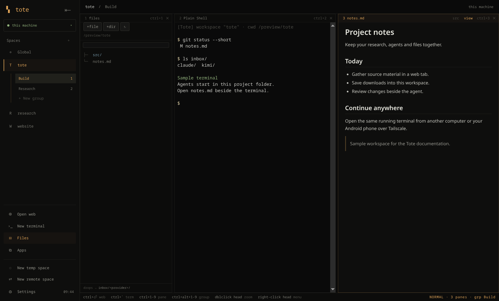
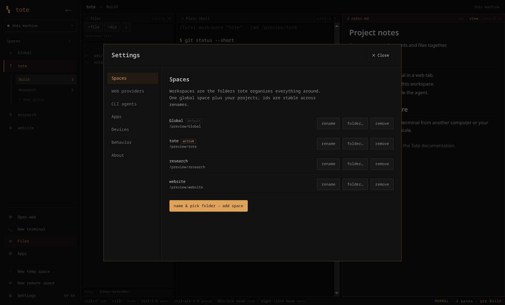
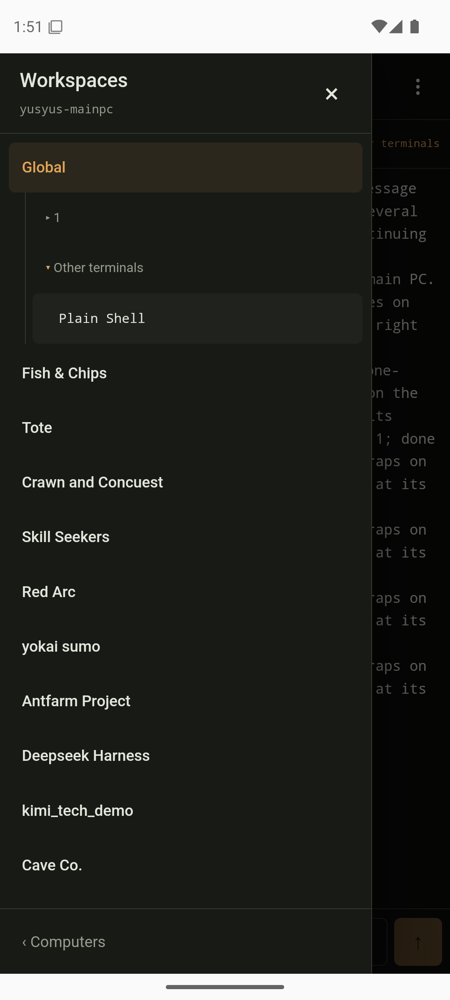
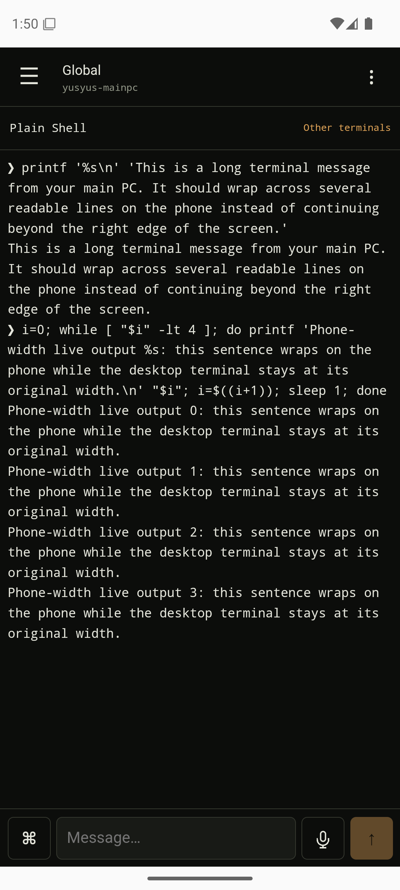
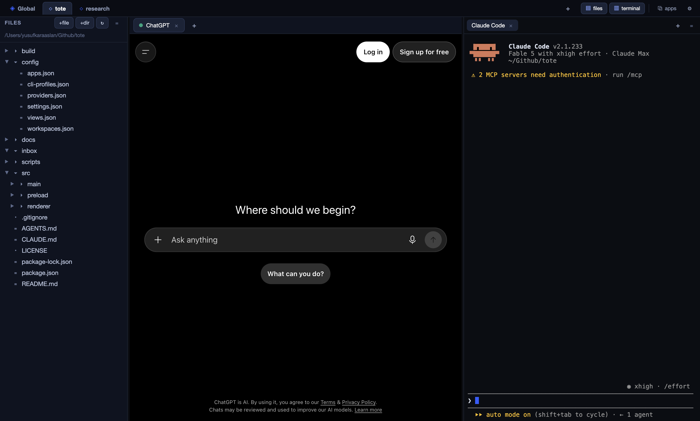
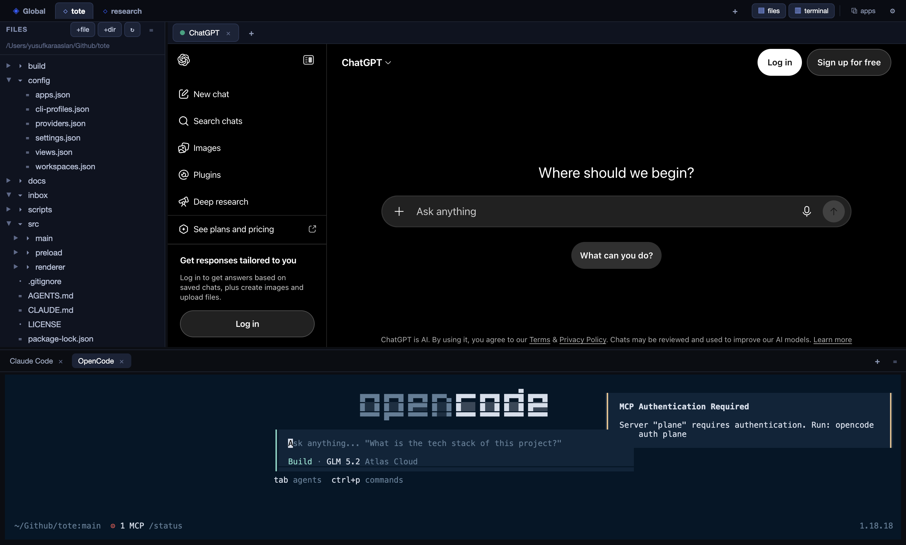
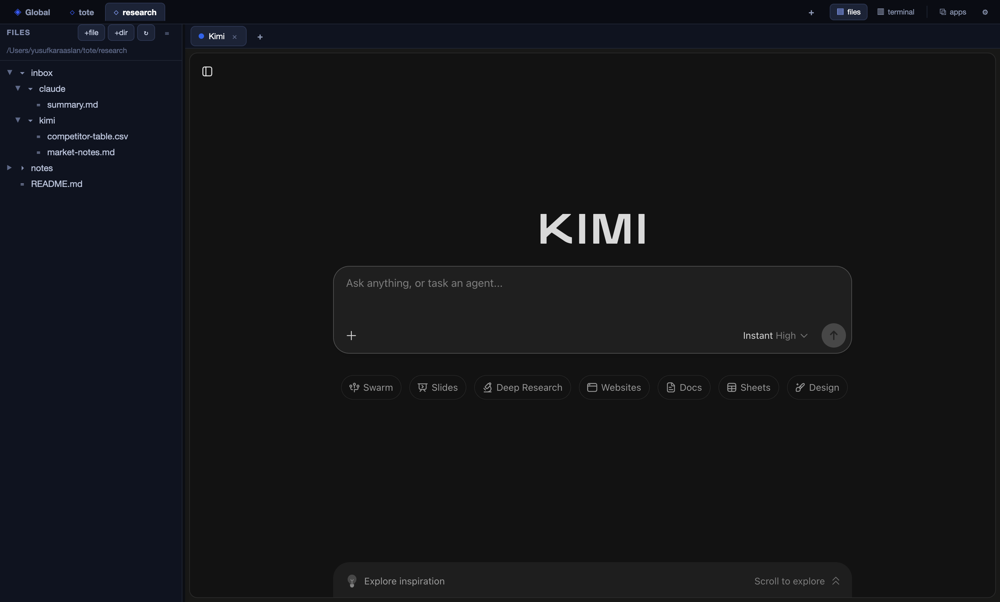
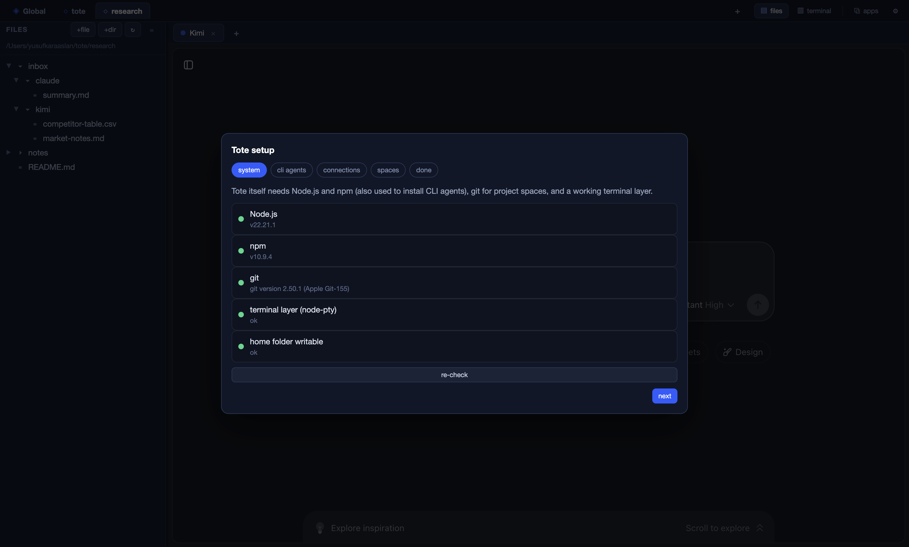
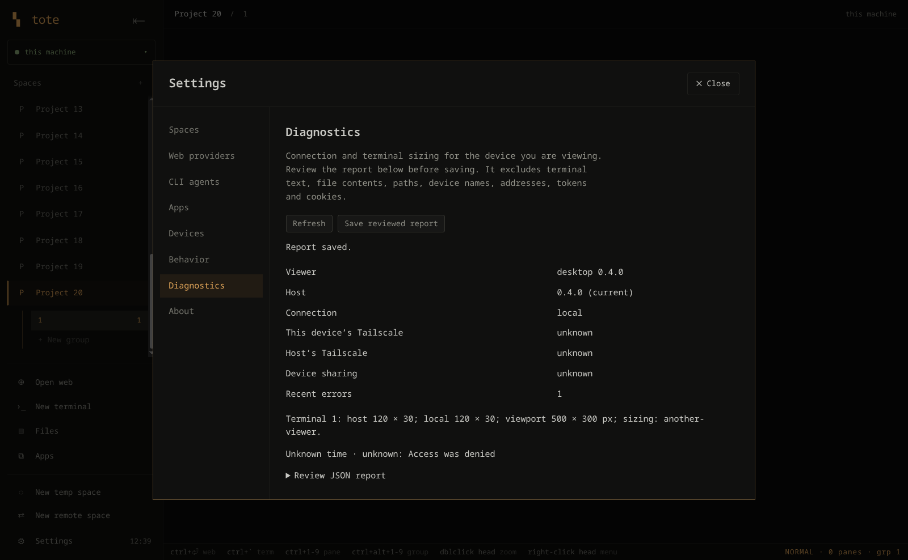

# Tote

**Your AI workspace, across your computers and Android phone.**

Tote brings web LLMs, CLI agents, files and project layouts into one desktop app.
Research in a web tab, save its downloads into your project, and continue with an
agent in a real terminal beside it. Connect from another computer or your Android
phone over Tailscale to use the same running agents.

*Tote: a bag you carry everything in.* Bring your own provider accounts and CLI tools;
Tote organizes their windows and files while each provider keeps its own conversations.

[Download](#download) · [Features](#features) · [Screenshots](#screenshots) ·
[Tailscale setup](#tailscale-setup) · [Android](#android-companion) ·
[Build from source](#build-from-source) · [Shortcuts](#keyboard-shortcuts)



*Current desktop UI with sample project content in an isolated preview.*

## Download

[**v0.5.0 release and checksums**](https://github.com/yusufkaraaslan/tote/releases/tag/v0.5.0) ·
[Release notes](docs/releases/v0.5.0.md) · [Changelog](CHANGELOG.md)

| Platform | Download |
|---|---|
| Linux x64 — portable | [AppImage](https://github.com/yusufkaraaslan/tote/releases/download/v0.5.0/Tote-0.5.0-linux-x86_64.AppImage) |
| Debian / Ubuntu x64 | [.deb package](https://github.com/yusufkaraaslan/tote/releases/download/v0.5.0/Tote-0.5.0-linux-amd64.deb) |
| Arch Linux x64 | [.pacman package](https://github.com/yusufkaraaslan/tote/releases/download/v0.5.0/Tote-0.5.0-linux-x64.pacman) |
| Android | [Android 13+ APK](https://github.com/yusufkaraaslan/tote/releases/download/v0.5.0/Tote-0.5.0-android.apk) |
| macOS / Windows | [Build from source](#build-from-source) |

Mark the AppImage executable before opening it. On Android, allow installation from
the app opening the APK when prompted. The APK uses Tote's production signing
identity and is distributed directly, outside the Play Store. v0.5.0 supplies Linux and Android binaries; macOS and Windows have
source build targets. This README describes the repository; release notes identify
what is included in the downloadable version.

## Start with a project

1. Open Tote and follow the setup wizard to check your system and install the CLI
   agents you want. Sign in to each provider or agent using its own login flow.
2. Add a workspace from the sidebar and choose an existing project folder, or use
   the default **Global** space at `~/tote/workspace`.
3. Use **Open web** to open a provider. Its downloads go into that workspace's
   `inbox/<provider>/` folder, such as `inbox/kimi/`.
4. Use **New terminal** to start an agent in the same project folder. Ask it to work
   with the downloaded file, then open its output in a file pane beside the terminal.
5. Enable **Settings → Devices → share this device** to reach its spaces and agents
   from your other computers and Android phone. Follow [Tailscale setup](#tailscale-setup).

## Features

### Spaces, groups and panes

- **Project workspaces:** one Global space plus your own folders, each with its own
  web tabs, terminals, documents and saved layout. Rename, reorder, change folders
  or remove spaces from the sidebar or Settings. Removing a regular space only
  unregisters it; changing its folder only updates the path.
- **Collapsible sidebar:** switch devices and workspaces, find groups nested beneath
  the active workspace, and drag workspace rows to save a new order.
- **Groups:** several layouts within one workspace, like virtual desktops. Hidden
  web tabs and agents keep running. Move panes between groups by dragging their
  title bars onto a group, using the title-bar menu, or using a shortcut.
- **Tiling panes:** web views, terminals and documents share a resizable layout.
  Drag title bars to rearrange, resize dividers, or zoom a pane. The files dock keeps
  the full left edge and remembers its width.
- **Temporary spaces:** create a scratch project without a folder picker. **Keep…**
  moves it to a permanent folder while preserving its layout. **Discard** deletes
  the temporary folder and its files. By default, temp spaces unused for seven days
  are swept at the next launch; these deletion rules apply only to temp spaces.
- **Multiple windows:** each window can view its own workspace while sharing host
  terminal sessions. Opening a session in another window replays its screen and
  scrollback. Sessions live in a separate background host; closing or quitting the desktop keeps them running. Stop the host explicitly in Settings → About.

### Web LLMs and CLI agents

| Interface | Included defaults |
|---|---|
| Web providers | ChatGPT, Claude, Gemini, Kimi, MiniMax, Z.ai, Qwen, DeepSeek |
| Local web UI | DeepSeek Harness (`npx -y @deepseek-ai/dsh web`), started on first use |
| CLI profiles | Claude Code, Codex CLI, Gemini CLI, Kimi Code CLI, OpenCode, plain shell |
| Native apps | Launch installed apps from the apps menu; configure entries in Settings |

- Open multiple tabs of the same provider. Provider logins use separate persistent
  browser partitions, and OAuth popups stay in the provider's session.
- Agents run in **real PTYs**, so interactive and full-screen terminal programs work.
  On POSIX systems, profiles launch through your login shell to find tools installed
  with shell-managed environments such as nvm, fnm or asdf.
- **Shift+Enter** inserts a newline in an agent prompt. Shift+arrows scroll terminal
  history; Alt+Up/Down reach agents that use them for prompt navigation.
- Desktop and mobile terminals retain up to **5,000 scrollback lines**. The default
  Codex profile uses `--no-alt-screen` so older messages remain in terminal history.
  Existing profiles are preserved: add `"--no-alt-screen"` to your Codex profile's
  `args` in `cli-profiles.json`, then start or resume Codex in a new terminal.
  This cannot recover lines already discarded by an existing terminal session.
- PTYs advertise truecolor and clear a launcher's inherited `NO_COLOR` setting.
  Shell startup files can still disable colors explicitly. Existing agents keep
  their original environment; updating the background host takes effect for new
  terminals after the old host is stopped when its sessions are finished.
- Drop a file onto a terminal to insert its shell-escaped path for you to review and
  send. Terminal context menus support Copy/Paste; plain Ctrl+C still interrupts.
- Add providers, CLI profiles and native apps in Settings. Defaults live in
  [`config/`](config/); runtime configuration is plain JSON, accessible through
  **Settings → About → open config folder**.

### Files, previews and downloads

- **Workspace inboxes:** web downloads go to the downloading window's active space,
  under `inbox/<provider>/`, including when viewing a shared device or SSH workspace.
- **File tree:** create, rename, trash, reveal, copy paths and open files externally.
  **Send to active tab** is an experimental way to attach a file to a web chat.
- **Editable documents:** text and code open in panes with explicit Save. Markdown,
  HTML and SVG have source/preview modes; HTML loads its own CSS, scripts and images.
  Images and PDFs are viewable on desktop; other formats open in a system app.
- **Side-by-side review:** click a file to reuse a document pane, or Cmd/Ctrl-click to
  open another. Clean documents refresh when a file changes; unsaved edits get a
  changed-on-disk prompt before replacement.
- **Native-app integration:** the wizard can bind Claude Desktop to a local workspace
  with a filesystem MCP server and a config backup, and provides a snippet for other
  MCP clients. Restart an already-running client to pick up a changed binding.
- **macOS Downloads bridge:** copies downloads attributed to known native LLM apps
  into `inbox/_desktop/`, leaving originals in Downloads. Toggle it in
  **Settings → Behavior**. Native apps open as separate applications.

### Your other computers

- **Shared Tote devices:** switch the device at the top of the sidebar to open that
  computer's spaces, files and running terminals. Each device's panes remain in the
  window, preserving web pages and drafts when you switch back.
- **Reconnect:** a sleeping or disconnected device keeps its panes under a banner;
  Tote reconnects when it returns. The host must stay running to preserve sessions.
- **Shared terminal sizes:** focusing or typing in a desktop terminal fits the shared
  session to that pane. Other viewers follow the host's grid, scrolling if needed;
  background layout changes cannot take sizing control. Update the host and viewers
  together to use this synchronization.
- **SSH workspaces:** open a project directory on another machine using
  **New remote space**. Files, edits, terminal processes and downloaded files live
  there. SSH authentication appears in a connect pane when needed.
- **Keep awake:** the Devices settings can prevent idle sleep on the viewed host
  while the host runs (macOS caffeinate, Windows power request, or Linux systemd-inhibit). This does not override closing a laptop lid, signing out, or stopping the host.

## Screenshots

The desktop preview above shows the current sidebar and pane layout. Settings
keeps spaces, providers, CLI agents, apps and devices in one place:



| Android workspace, group and terminal navigation | Android terminal output wrapped to phone width |
|---|---|
|  |  |

<details>
<summary>Earlier desktop captures: agent layouts, research and setup wizard</summary>

These show the earlier desktop chrome and illustrate the web-to-agent workflow.



| Agents below the web view | Research with provider inboxes |
|---|---|
|  |  |



</details>

## Tailscale setup

Tote offers two ways to work across machines:

| Choose | Use it for | What the other computer needs |
|---|---|---|
| **Shared device** | Continue running Tote terminals and browse its existing spaces from desktop or Android | Tote running with **share this device** enabled, plus Tailscale |
| **SSH workspace** | Work in a remote project folder and start agents there from desktop Tote | An SSH server, shell and desired CLI tools; Tote is not required there |

### 1. Connect your devices to Tailscale

Install [Tailscale for your platforms](https://tailscale.com/docs/install), sign in,
and connect it on each computer and your Android phone. For Tote device sharing,
use devices owned by the **same Tailscale account**. Membership in the same tailnet
alone is insufficient: Tote rejects another owner's devices and shared-in nodes.

On a desktop, these commands help confirm that Tailscale is connected:

```sh
tailscale status
tailscale ip -4
```

The address is a Tailscale IPv4 address in `100.64.0.0/10`. Tote uses the installed
Tailscale CLI for discovery and identity checks; it also detects the macOS app's
bundled CLI. Tailscale is only needed for device sharing and Tailscale-based remote
access; local workspaces work without it.

### Background host

Tote starts a separate host for this computer and reconnects to it on later launches.
Closing every window or quitting the desktop leaves agents, Tailscale sharing and
host file watching running. **Settings → About → Background host** shows its
version and active terminal count, provides **Start host / Stop host**, and offers
opt-in **Start the host when I sign in**. Stopping a busy host requires confirmation.

Reboots, sign-out and a host crash still end its processes; starting again does not
resubmit terminal input or revive a dead agent. Use the agent's own resume command.
Desktop unsaved documents and provider drafts still belong to the desktop process.
See [background host operation and troubleshooting](docs/background-host.md).

### 2. Share a desktop Tote host

1. Open Tote on the computer with your projects and agents.
2. Open **Settings → Devices** and enable **share this device**.
3. Confirm that the device settings show its shared address. Enable **keep this
   machine awake** if you want it reachable while idle.
4. Leave Tote running. On another desktop running Tote, use the device selector at
   the top of the sidebar to choose the shared computer. The viewing computer only
   needs sharing enabled if you also want to connect back to it.

Device sharing uses Tote's own connection over Tailscale and does **not** require
Tailscale SSH. It listens only on the host's Tailscale address, normally TCP
`47821`, and checks callers with `tailscale whois`. Tailscale provides the encrypted
network connection; there is no Tote cloud account, API key or pairing code.

Web-provider logins remain local to the viewing desktop. The selected host supplies
its files and terminals; actions requiring local desktop apps or its disk directly
may be unavailable while viewing another device.

### 3. Connect Android

1. Install the [Android APK](https://github.com/yusufkaraaslan/tote/releases/download/v0.5.0/Tote-0.5.0-android.apk)
   and connect the Tailscale Android app with the same owner account.
2. With sharing enabled on the computer, open Tote on the phone and wait a few
   seconds for discovery, then choose the computer.
3. Open the **☰** side panel and select a workspace, group and terminal.

Automatic discovery travels through Tailscale, including to a phone on mobile data
from a wired desktop. It needs no matching Wi-Fi, LAN scan, QR code or router port
forwarding. Hosts send hints to their own online Android peers; the phone verifies
each candidate with the host before remembering it.

### Network rules and troubleshooting

For a tailnet with custom access rules or host firewalls, allow these connections
between your own devices:

| Connection | Destination port | Purpose |
|---|---|---|
| Viewing desktop or phone → shared Tote host | TCP `47821` by default | Device discovery probes, files and live terminals |
| Shared Tote host → Android phone | UDP `47822` | Automatic discovery hints |
| Desktop → SSH host, when using remote spaces | TCP `22` by default | SSH files and terminals |

`devicePort` in Tote's runtime `settings.json` changes the device server port;
keep desktop discovery clients configured to the same port. No public listener or
router forwarding is needed. Custom Tailscale policies still control reachability;
see [Tailscale client preferences](https://tailscale.com/docs/features/client/manage-preferences)
for incoming-connection settings.

- **No shared computer listed:** confirm Tailscale is connected on both devices,
  ownership matches, Tote is running, and sharing is enabled. Check the Tailscale
  status/error shown in **Settings → Devices**.
- **Android cannot discover it:** use a desktop build with Android discovery,
  reopen the phone's computer picker, and check UDP `47822`. Tailscale's
  **block incoming connections** setting on the phone can prevent hints arriving.
  **Connect by address instead** accepts the host's Tailscale IPv4 and device port
  as a fallback; a remembered host can reconnect without fresh hints.
- **The host appears but cannot connect:** verify the TCP device port is allowed
  and the host has not gone to sleep. A reachable Tailscale peer still needs Tote
  running with sharing enabled.
- **Sharing reports no Tailscale CLI:** confirm `tailscale status` works on the host,
  then restart Tote after fixing installation or PATH.

### Optional: open an SSH workspace

First establish SSH access from the computer running desktop Tote. You can use an
existing OpenSSH server over Tailscale, or enable Tailscale SSH on a supported host.
For example, on a Linux host:

```sh
sudo tailscale set --ssh
```

Tailscale SSH also requires network access and an SSH rule in your tailnet policy.
Its server supports Linux and the macOS open-source CLI daemon; the macOS GUI app
and Windows cannot serve Tailscale SSH. Follow the
[official Tailscale SSH setup](https://tailscale.com/docs/features/tailscale-ssh).

Then, from the viewing computer, test your destination (replace these examples):

```sh
ssh alice@devbox
```

Choose **New remote space** in Tote's sidebar, enter `alice@devbox` (or an SSH config
alias), and the remote folder, such as `/home/alice/projects/demo`. Install the CLI
agents you want on that remote host. Tote shares one SSH connection between its
file operations and real terminal sessions, and stages web downloads before
uploading them into the remote inbox.

When SSH or Tailscale SSH needs authentication, use the files-pane banner and connect
pane to complete it. This SSH flow is separate from opening a shared Tote device.

## Android companion

The Android app connects to a desktop host; your files and agent processes stay on
that computer. Start with [the connection steps above](#3-connect-android).

| Capability | Behavior |
|---|---|
| Navigation | Side drawer for computers, workspaces, groups and terminals |
| Live terminals | Screen/scrollback replay, live output, input, reconnect and foreground resume |
| Phone reading | Wraps parsed terminal output to the phone width with terminal colors and styles; **Wrap text** switches to the original grid |
| Terminal size | Preserves host dimensions on attach; **Resize terminal** explicitly changes the shared PTY for all viewers |
| Input | Multiline composer, separate Send, Esc, Tab, arrows, Enter and Ctrl+C |
| Voice | Microphone → record → Stop → editable transcription; sending is a separate action |
| Drafts | Separate in-memory draft per session; reconnect never retries input; Android process termination clears drafts |
| New terminals | Start a host CLI profile; sessions appear under **Other terminals** until arranged on desktop |
| Files | Read-only tree with text/source and image previews; HTML is shown as source |

Phone navigation does not rearrange or save the desktop layout. Speech uses Android's
configured recognition service and current language, and may require a network
connection. Tote does not retain audio files.

The preview does not yet include mobile web-provider tabs, PDF/binary previews,
file editing or transfers, desktop app launch, creating/rearranging groups,
agent-status notifications, or background audio recording. There is no iOS client
in this repository.

See the [Android README](mobile/README.md) for native development, testing,
simulation tools and physical-device verification limits.

## Keyboard shortcuts

Use **Cmd** on macOS and **Ctrl** on Linux/Windows where shown as Cmd/Ctrl.

| Action | Shortcut |
|---|---|
| Focus an existing terminal or open the terminal picker | Ctrl+backtick |
| New window | Cmd/Ctrl+Shift+N |
| Open web picker | Cmd/Ctrl+Enter |
| Focus pane 1–9 | Cmd/Ctrl+1…9 |
| Focus neighboring pane | Cmd/Ctrl+Alt+arrow |
| Move pane toward a neighbor | Cmd/Ctrl+Alt+Shift+arrow |
| Zoom/unzoom focused pane | Cmd/Ctrl+Alt+F, or double-click its title bar |
| Close focused pane | Cmd/Ctrl+Alt+W |
| Switch group | Cmd/Ctrl+Alt+1…9 |
| Move pane to group | Cmd/Ctrl+Alt+Shift+1…9 |
| Save document | Cmd/Ctrl+S |
| Toggle document source/preview | Cmd/Ctrl+Alt+E |
| Newline in terminal prompt | Shift+Enter |
| Scroll terminal history / jump to ends | Shift+Up/Down / Shift+Home/End |
| Terminal copy/paste | Cmd+C/V on macOS; Ctrl+Shift+C/V on Linux/Windows |

On Linux/Windows, a focused terminal retains Ctrl+Enter and Ctrl+1…9 for its program.
Scrollback shortcuts pass through to applications using the alternate terminal
screen. Ctrl+C remains the terminal interrupt.

## Build from source

### Desktop

Use **Node.js 22.12+**, npm and Git. Desktop builds use Electron 45 and require macOS 13+ or a supported 64-bit Windows/Linux system. A C++ toolchain may be needed for node-pty:

| Platform | Build prerequisites |
|---|---|
| Debian / Ubuntu | `sudo apt install build-essential python3` |
| Fedora | `sudo dnf install gcc-c++ make python3` |
| macOS | Xcode Command Line Tools: `xcode-select --install` |
| Windows | Visual Studio Build Tools with C++ support and Python |

```sh
git clone https://github.com/yusufkaraaslan/tote.git
cd tote
npm install
npm start
```

On Linux/macOS, `./scripts/install.sh` checks prerequisites, installs dependencies
and launches Tote. First launch opens the setup wizard: system checks, CLI installs,
Claude Desktop/MCP connections and workspaces. Reopen it under
**Settings → About → run setup wizard**. CLI installs can recover from blocked npm
install scripts and safely repair a root-owned global npm prefix when applicable.

```sh
npm run dist        # installers for the current platform → dist/
npm run dist:linux  # AppImage, .deb and .pacman
npm run dist:pacman # Arch/Manjaro package
npm run dist:mac    # .dmg; build on macOS
npm run dist:win    # NSIS .exe with install-directory selection
npm run install:mac # test, build and install into /Applications on macOS
```

The macOS install script stages its update separately and can wait for a running
Tote to quit before reopening the updated app. Older OmniHub configuration, logins
and Claude Desktop binding are migrated at first launch; quit OmniHub first.

If a terminal fails with `posix_spawnp failed`, rerun `npm install`: postinstall
restores the executable bit on node-pty's spawn helper and copies xterm assets.

### Android APK

Use **Node.js 22+**, **JDK 21** and **Android SDK platform 36** with the Android build
tools. Set `JAVA_HOME` and `ANDROID_HOME`, or configure `sdk.dir` in the untracked
`mobile/android/local.properties`.

From the repository root:

```sh
npm ci
npm ci --prefix mobile
npm run mobile:apk
```

Output: `mobile/android/app/build/outputs/apk/debug/app-debug.apk`.
To install on a connected phone with USB debugging enabled:

```sh
adb install -r mobile/android/app/build/outputs/apk/debug/app-debug.apk
```

Use `npm --prefix mobile run android` to sync assets and open Android Studio.
Android 0.5.0 source requires Android 13+. The [release workflow](docs/releases.md) verifies its dedicated production identity and approved signing history; see [key custody and migration](mobile/signing/README.md). Play Store packaging is not configured.

### Checks

```sh
npm test                 # desktop checks plus mobile protocol, model and reading tests
npm run test:sidebar-ui   # isolated desktop Electron UI with a fake host
npm run test:background-ui # real host/PTY survives desktop quit, crash and relaunch
npm run test:terminal-ui  # two desktop renderers sharing a host terminal mirror
npm run test:layout-sync-ui # layout conflicts, unsaved buffers and device switches
npm run test:provider-ui  # isolated real app: provider cookies, popups and downloads
npm run test:mobile-ui    # isolated mobile UI with fake network and speech
```

For native Android checks, run `./gradlew testDebugUnitTest lintDebug` from
`mobile/android`. UI checks need a graphical session. Physical-device checks are
still needed for Android Tailscale networking, speech, keyboard behavior and
background/foreground recovery.

[GitHub Actions](https://github.com/yusufkaraaslan/tote/actions/workflows/validation.yml)
runs the full logic suite on Linux, macOS and Windows with Node 22, the six
renderer checks under a Linux virtual display, and Android native tests, lint and
a debug APK build with JDK 21 and SDK 36. Android reports and the preview APK are
kept as workflow artifacts for seven days. These checks use isolated fixtures;
they do not verify live Tailscale accounts, real agent sessions, native desktop
installers, or the physical-device behaviors above.

### Configuration recovery

Tote saves each JSON file in its application-data `config` folder through a flushed
temporary file and an atomic rename. A sibling `.bak` holds the preceding valid
distinct version; unchanged saves leave the backup intact. On first use, it contains
the initial configuration. Missing JSON or an invalid top-level structure is
restored from that backup with a notice; damaged bytes remain in a
`.corrupt-…` file for inspection. If neither copy is usable, Tote reports the path
and stops startup so you can restore it, instead of opening an empty configuration.

Backups cover settings, workspaces, provider and CLI profiles, apps and saved
layouts. They do not back up workspace files or unsaved editor buffers. Only one
prior distinct version is retained.
Recovery assumes the filesystem supports atomic sibling renames; Windows flushes
the file, while supported POSIX filesystems also flush the containing directory.
An abrupt process exit can leave an unused `.tmp` file, which Tote ignores.

### Shared layout conflicts

Desktop windows save only changed workspaces, with a revision checked by the
host. Editing separate spaces does not overwrite each other's layouts. When two
viewers edit the same space, a banner keeps the local layout available and offers
**Use saved layout** or **Replace saved layout**. Replacement requires confirmation
and is checked again if another edit arrived meanwhile. Save or close affected
unsaved documents before loading a layout that removes or retargets them.

Pending saves remain bound to their original device across switches and
reconnects. They remain in memory until acknowledged; quitting the app still loses
uncommitted local layout drafts. Existing pane elements remain in place when their
instances survive an update.

Update both desktops for the conflict UI. An older desktop talking to an updated
host can save against its last layout read, but stale writes are rejected; reload
that window to refresh its baseline. An updated viewer on an older host shows a
notice and keeps layout changes local until the host is updated. Android keeps
its own group and pane selection and never saves desktop layouts.

### Slow or interrupted device connections

Tote detects stalled links and limits queued terminal output and pending calls.
If a viewer falls behind, it shows the reason and reconnects with a fresh terminal
replay; the host's sessions and other viewers keep running. Draft input stays
local and is never resent automatically. Update both desktops and Android for
output acknowledgements after terminal parsing. See [connection limits and
recovery](docs/device-transport.md) for compatibility, limits and test coverage.

### Connection and terminal diagnostics

Open **Settings → Diagnostics** on desktop, or **⋮ → Diagnostics** in an Android workspace. Android also offers Diagnostics on the Computers screen, before connecting.

The panel shows viewer/host versions, connection state, Tailscale availability, sharing failures, recent categorized errors, and each terminal's host grid, local viewport and sizing controller. This helps distinguish a narrow phone viewport from a shared PTY resize. A disconnected device can show the last collected host snapshot, explicitly marked **cached**; older hosts show **unsupported**, with local sizing still available.

Expand **Review JSON report**, inspect the snapshot, then choose **Save reviewed report**. Desktop uses a file picker; Android uses its document picker. Nothing is uploaded automatically. Reports exclude terminal output, file contents, paths, device names/addresses, session IDs, tokens and browser cookies. They retain at most 64 anonymous terminal rows and 50 categorized errors, with a 64 KiB export limit. Raw error strings are discarded when recorded; recent errors are memory-only and cover this app run. Android reports whether Tailscale is installed, not whether its VPN is active.



See [Android diagnostics and physical-device checks](mobile/README.md#diagnostics).

### Releases and update checks

Desktop **Settings → About → Check for updates** and Android **Updates** check published stable GitHub releases on demand. Linux AppImage users can **Download update → Install and reopen**; Android users can download a verified production APK and confirm installation in Android. Downloads show progress, can be canceled, and are checked again before installation. Desktop blocks installation while documents or layouts are unsaved in any window/device; Android blocks it while phone drafts remain. Background hosts and agents keep running. Upgrade the host separately after finishing its sessions. Linux `.deb`/pacman installations use their package manager; macOS/Windows retain manual installation. The first release containing this updater still needs a manual installation; later compatible releases use the in-app flow. See [update installation and recovery](docs/self-updates.md).

Desktop and Android share version **0.5.0**. Version checks, preview packaging, signed-release configuration, checksums, and the draft-release workflow are documented in [Releases and updates](docs/releases.md). See the [0.5.0 release notes](docs/releases/v0.5.0.md) for changes, upgrade instructions and verification limits.

Dependency proposals, advisory monitoring, Electron support checks and the upgrade validation checklist are documented in [Dependency maintenance](docs/dependencies.md). Run `npm run dependencies:report` to inspect current lockfile advisories and runtime support; existing findings remain visible until fixed.

## Architecture

```text
config/          JSON defaults for providers, agents, apps, spaces and settings
src/host/        Electron-free host: workspace routing, sessions, protocol, sharing
                 server, Tailscale identity and Android discovery
src/main/        Electron lifecycle, device clients, downloads, app launch, setup,
                 workspace filesystem backends, SSH connections and PTYs
src/preload/     Context-isolated window.tote bridge
src/renderer/    Vanilla JS desktop UI, tiling engine, documents and xterm
mobile/          Capacitor Android viewer, native networking/discovery and speech
scripts/         Setup, packaging helpers and regression checks
```

A **host** owns spaces, files, saved layouts, watchers and PTYs. Each desktop window
or Android connection is a **viewer** with its own active workspace. Host calls
resolve that viewer's space at call time; they do not depend on a single global
active folder. Desktop windows use IPC to their main process, which connects to
the separate host over authenticated loopback WebSocket. Remote viewers use the
same bounded protocol inside Tailscale.

A headless terminal mirror supplies replay to new viewers, so a session belongs
to the host rather than a window. Closing every desktop window or quitting the UI
leaves sessions available. Explicitly stopping the host ends them.
Workspace paths go through containment checks, and the desktop renderer has no
Node.js access. The Android viewer never hosts files or terminals.

Further implementation notes: [AGENTS.md](AGENTS.md),
[device architecture](docs/superpowers/specs/2026-10-12-devices-design.md) and
[Android development](mobile/README.md).

## Roadmap

The [feature backlog](https://github.com/yusufkaraaslan/tote/issues?q=is%3Aissue+is%3Aopen+label%3Aenhancement)
tracks the proposed improvements and their acceptance criteria. The first
[stabilization milestone](https://github.com/yusufkaraaslan/tote/milestone/1)
covers safe persistence, automated checks, shared-device reliability, diagnostics
and updates.

- Global hotkey and tray access.
- Per-workspace download routing rules.
- House agent via DeepSeek Harness with workspace tools.
- Send selections and conversation context between panes.

## License

[MIT](LICENSE)
